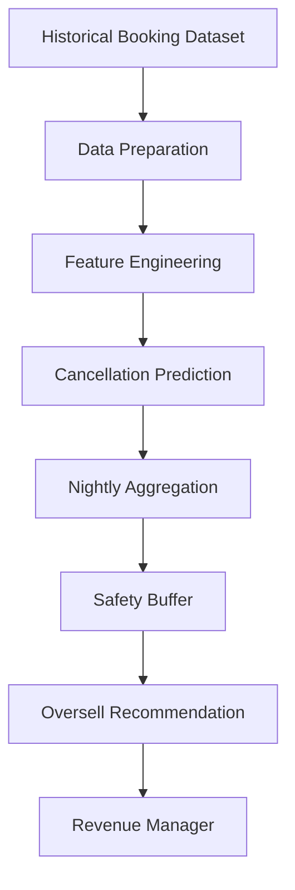
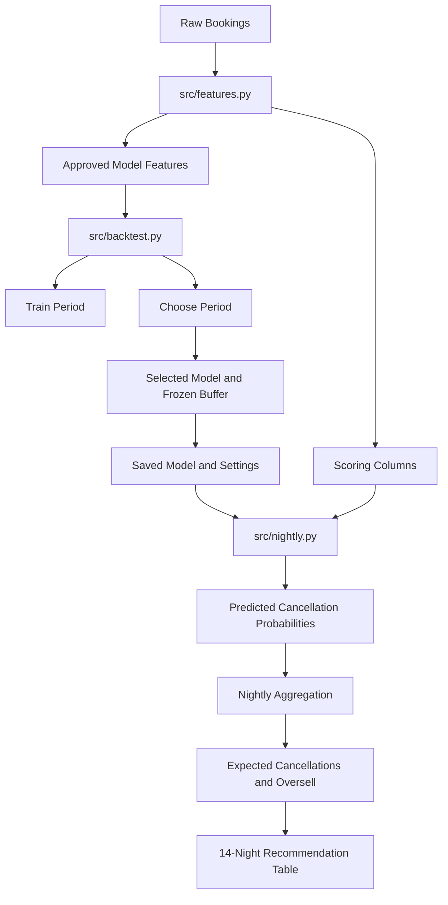

# Product Requirements Document (PRD)
## Hotel Overbooking Recommendation System

**Project:** Project Oversell – IIT Gandhinagar  
**Role:** Build Lead  
**Hotels:** City Hotel (Lisbon) and Resort Hotel (Algarve)  
**Status:** MVP specification

---

## Q1. Who is the user, and what decision do they make?

The primary user is the Director of Revenue / Revenue Manager responsible for two hotels in Portugal:

- City Hotel – Lisbon
- Resort Hotel – Algarve

Every morning, the user needs to decide how many bookings beyond the physical room capacity can safely be accepted for each hotel and each of the next 14 arrival nights.

The system will support this decision by estimating the number of cancellations expected for each arrival night and recommending an appropriate oversell quantity.

The final decision remains with the Revenue Manager.

## Q2. What approaches will we compare?

The project will compare the following approaches:

1. **Client baseline:** A flat-rule approach using each hotel's historical training-period cancellation rate and a fixed safety margin.
2. **Lookup-based approach:** A rule-based approach using historical cancellation behaviour for relevant booking groups.
3. **Machine-learning approach:** A predictive model that estimates the cancellation probability of each booking using information available at booking time.

The final approach will be selected using the choose-period results.

The selected approach must:
- Respect the maximum walk-rate limit.
- Reduce the business cost compared with the client baseline where possible.
- Avoid using information that would not have been available at booking time.
- Produce consistent hotel-by-night recommendations.

**Final selected method:** To be completed after reviewing the actual backtest results.

## Q3. What client wish-list requirement must be addressed?

The exact client wish-list requirement must be taken from the supplied project brief or RFP.

**Requirement:** [Insert the exact wish-list item from the RFP/project brief.]

**Our response:** [Explain how the MVP addresses the requirement.]

Do not replace this with an assumed requirement. Confirm the wording against the source document before final submission.

## Q4. What will the MVP deliver?

The MVP will generate a recommendation table for the next 14 arrival nights for both hotels.

Each row will represent one hotel and one arrival night.

The output will contain:

| Column | Description |
|---|---|
| hotel | City Hotel or Resort Hotel |
| arrival_date | Guest arrival date |
| bookings_on_book | Number of bookings currently represented in the input data |
| expected_cancellations | Sum of predicted cancellation probabilities |
| buffer | Safety margin applied to account for uncertainty |
| recommended_oversell | Recommended number of bookings beyond room capacity |

The output will help the Revenue Manager understand the expected cancellation volume and the recommended overselling decision.

## Q5. What data will the model use?

The original dataset contains 119,390 booking records and 32 columns.

The MVP model will use the 23 booking-time predictor columns approved in `docs/COLUMNS.md` and implemented in `src/features.py`.

The approved model predictors are:

1. hotel
2. lead_time
3. arrival_date_year
4. arrival_date_month
5. arrival_date_week_number
6. arrival_date_day_of_month
7. stays_in_weekend_nights
8. stays_in_week_nights
9. adults
10. children
11. babies
12. meal
13. country
14. market_segment
15. distribution_channel
16. is_repeated_guest
17. previous_cancellations
18. previous_bookings_not_canceled
19. reserved_room_type
20. deposit_type
21. agent
22. company
23. customer_type

**Prediction target:**

`is_canceled`

This is the outcome the model must predict. It must never be included as a predictor.

**Scoring columns:**

The following columns are required by the business scoring contract but are not all model predictors:

- hotel
- arrival_date
- is_canceled
- adr
- nights

`adr` and `nights` are used to calculate the stay value for business-cost evaluation.

**Leakage prevention:**

The model must not use information that becomes available only after the booking outcome, including:

- reservation_status
- reservation_status_date

Other columns classified outside the first bin in `docs/COLUMNS.md` must not be introduced as model predictors without an explicit review and approval.

## Q6. How will the system work?

The MVP follows three main stages.

### Stage 1: Feature preparation

File: `src/features.py`

Responsibilities:
- Prepare the raw booking dataset.
- Handle the approved missing-value cases.
- Derive arrival dates and total nights.
- Separate model predictors from scoring columns.
- Prevent target leakage.

### Stage 2: Model training and backtesting

File: `src/backtest.py`

Responsibilities:
- Train candidate methods using the training period.
- Select the method and safety settings using the choose period.
- Compare candidate methods against the client baseline.
- Evaluate the frozen approach on the proof period only after selection.
- Save the selected model and required settings for the nightly pipeline.

### Stage 3: Nightly recommendation generation

File: `src/nightly.py`

Responsibilities:
- Read the prepared booking data.
- Load the selected model and saved settings.
- Estimate cancellation probabilities.
- Aggregate predictions by hotel and arrival night.
- Calculate expected cancellations and the recommended oversell quantity.
- Generate the 14-night recommendation table.

### Evaluation periods

| Period | Arrival-date range | Purpose |
|---|---|---|
| Train | Before 2016-07-01 | Train models and estimate historical patterns |
| Choose | 2016-07-01 to 2016-12-31 | Select the method and freeze safety settings |
| Proof | 2017-01-01 onward | Final evaluation of the frozen method |

The proof period must not be used to tune models, select methods or change safety buffers.

### Business-cost calculation

For each hotel and arrival night:

- `A` = actual cancellations for that night.
- `k` = oversell quantity.
- Empty rooms = `max(A - k, 0)`.
- Walked guests = `max(k - A, 0)`.
- `V` = mean stay value for that night, calculated using `adr * nights`.

The cost is:

`Cost = (Empty rooms * V) + (Walked guests * 300)`

The walk cost is €300 per walked guest.

The walk rate is:

`Walk rate = 1000 * Total walked guests / Total arrivals`

The hard guardrail is a maximum of 10 walked guests per 1,000 arrivals.

Any policy exceeding this limit must be rejected, even if its total cost is lower.

The exact model filename, prediction interface and frozen buffer calculation must be confirmed with the Model Lead before integration into `nightly.py`.

## Q7. How will we measure success?

The project will evaluate the selected approach against the client baseline using the supplied business contract.

The proof-period comparison must report:

| Metric | Client baseline | Selected approach |
|---|---:|---:|
| Total empty rooms | To be filled from proof results | To be filled from proof results |
| Total walked guests | To be filled from proof results | To be filled from proof results |
| Walks per 1,000 arrivals | To be filled from proof results | To be filled from proof results |
| Total business cost (EUR) | To be filled from proof results | To be filled from proof results |
| Walk-rate guardrail | Must be <= 10 | Must be <= 10 |

Success criteria:

1. The selected approach must respect the walk-rate guardrail.
2. Its cost should be lower than the client baseline, if the proof results support that conclusion.
3. It must generate a valid recommendation for each hotel and arrival night.
4. It must use only approved booking-time model features.
5. The evaluation must follow the train, choose and proof separation.

All numerical results must be copied from the actual backtest output. No results should be estimated or fabricated.

## Q8. What is the system architecture?

### Black-box architecture

### White-box architecture

### Possible production architecture additions

The MVP is a local, offline recommendation pipeline. A production version could add:

- Integration with the hotel's live booking-management system.
- Automated daily execution.
- A dashboard for revenue managers.
- Monitoring of cancellation prediction performance.
- Model retraining and version management.
- Manual recommendation overrides with an audit trail.
- Alerts for nights approaching the walk-risk limit.
- Booking snapshots to support true as-of-date recommendations.

## Q9. What are the limitations?

1. The dataset contains historical bookings and does not provide a live connection to the hotel's booking system.
2. The current MVP uses the available booking dataset rather than a continuously updated booking snapshot.
3. The final-book dataset may include bookings that were made after the 14-day decision point.
4. Therefore, the current offline evaluation does not perfectly represent the information available to a Revenue Manager 14 days before arrival.
5. Cancellation behaviour may change over time because of seasonality, pricing, customer mix and external conditions.
6. The model estimates cancellation probabilities; it cannot guarantee the actual number of cancellations.
7. The walk-rate guardrail must be checked carefully before operational use.

## Q10. What are the main risks and mitigations?

| Risk | Impact | Mitigation |
|---|---|---|
| Target leakage | Unrealistically good model performance | Use only approved booking-time predictors |
| Overfitting | Poor performance on future bookings | Use chronological train, choose and proof periods |
| Excessive overselling | Guests may need to be relocated | Enforce the 10-per-1,000 walk-rate ceiling |
| Under-overselling | Empty rooms and lost revenue | Compare expected cancellations and safety buffers |
| Incorrect model integration | Invalid nightly recommendations | Agree on model interface and test predictions |
| Changing cancellation behaviour | Model performance may deteriorate | Monitor performance and plan periodic retraining |
| Final-book information leakage | Offline results may overstate practical performance | Document the limitation and develop an as-of-date roadmap |

## Q11. What is out of scope for the MVP?

The following items are outside the current MVP scope:

- Live integration with hotel booking-management software.
- Automatic acceptance or rejection of bookings.
- Automatic relocation or walk management.
- Live pricing and room-rate optimisation.
- A fully deployed web dashboard.
- Automated cloud deployment.
- Real-time model retraining.
- Production monitoring and alerting.

These items may be considered for future development.