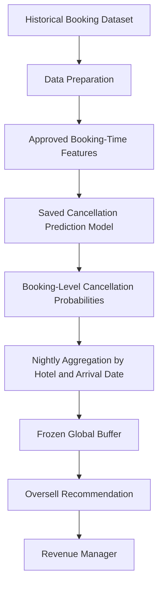
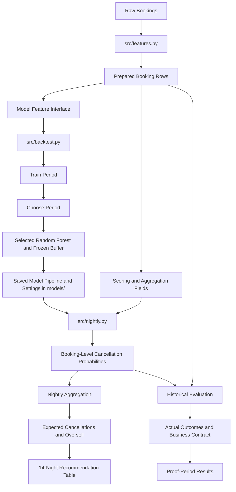

# Product Requirements Document (PRD)
## Hotel Overbooking Recommendation System

**Project:** Project Oversell – IIT Gandhinagar
**Role:** Build Lead
**Hotels:** City Hotel (Lisbon) and Resort Hotel (Algarve)
**Status:** MVP implementation and corrected follow-up evaluation reported (2026-11-16); see the historical Proof-exposure caveat in `docs/DECISIONS.md`.

---

## Q1. Who is the user, and what decision do they make?

The primary user is the Director of Revenue / Revenue Manager responsible for two hotels in Portugal:

- City Hotel – Lisbon
- Resort Hotel – Algarve

Every morning, the user needs to decide how many bookings beyond the physical room capacity can safely be accepted for each hotel and each of the next 14 arrival nights.

The system supports this decision by estimating the number of cancellations expected for each hotel-arrival night and recommending an appropriate oversell quantity.

The final decision remains with the Revenue Manager. The MVP provides recommendations and does not automatically accept or reject bookings.

## Q2. What approaches will we compare?

The project compares the following approaches:

1. **Client baseline:** A flat-rule approach using each hotel's historical training-period cancellation rate and a fixed safety margin.
2. **Lookup-based approach:** A rule-based approach using historical cancellation behaviour for relevant booking groups.
3. **Machine-learning approach:** A predictive model that estimates the cancellation probability of each booking using information available at booking time.

Candidate methods are fitted using the training period. Method and safety-setting selection must use the Choose period. The selected, frozen approach is then evaluated on the Proof period.

### Current model selection

The Model Lead has confirmed the following selected machine-learning model:

- **Model:** Random Forest
- **Number of estimators:** 100
- **Maximum depth:** 12
- **Minimum samples per leaf:** 20
- **Choose-period AUC:** 0.821727
- **Choose-period MAE:** 7.432268
- **Choose-period walks per 1,000:** 8.15 (within the maximum of 10)
- **Choose-period cost:** EUR 1,384,174.34
- **Choose-period savings versus Flat Rule:** EUR 1,003,755.30
- **Logistic Regression Choose-period AUC:** 0.8168
- **Frozen global buffer:** 3 rooms

The Model Lead has also confirmed that `arrival_date_year` is intentionally excluded from the selected classifier. The training period contains 2015 and 2016, while the Proof period and intended later use contain 2017 onward. Excluding the year prevents the tree-based model from relying on year-specific splits that may not generalise to later years. Seasonality is represented through `arrival_date_month` and `arrival_date_week_number`.

The fitted Random Forest pipeline and frozen buffer were persisted in `models/selected_policy.joblib` before Proof scoring. The selected model was fitted on Train; model and buffer selection used Choose only.

The selected approach must:

- Respect the maximum walk-rate limit.
- Reduce business cost compared with the client baseline where the Proof results support that conclusion.
- Avoid using information unavailable at booking time.
- Produce consistent hotel-by-night recommendations.
- Use the same saved preprocessing and feature interface during nightly inference as during model training.

AUC is used as a model discrimination metric. It does not by itself establish that an overselling policy satisfies the business-cost and walk-rate requirements. Those requirements must be evaluated separately using the supplied Evaluation Contract.

## Q3. What client wish-list requirement must be addressed?

**Exact client requirement:**

"Our marketing team would love to find our hidden guest types."

**Our response:**

The MVP explores differences in cancellation behaviour across available booking characteristics, particularly market segment and customer type. Descriptive analysis of these groups can help the hotel understand which types of bookings have different cancellation patterns.

The initial analysis has examined cancellation rates by market segment and customer type. However, the current MVP does not claim to have discovered statistically validated hidden guest clusters.

The primary objective remains reliable cancellation prediction and cost-effective nightly overbooking. More advanced guest segmentation, including clustering, may be considered as a future extension if it identifies meaningful, interpretable and actionable groups that can support marketing decisions.

Any future segmentation must be validated using historical data and must not introduce target leakage or compromise the overbooking system's walk-rate guardrail.

## Q4. What will the MVP deliver?

The MVP will generate a recommendation table for the next 14 arrival nights for both hotels.

Each row represents one hotel and one arrival night.

The required output columns are:

| Column | Description |
|---|---|
| `hotel` | City Hotel or Resort Hotel |
| `arrival_date` | Guest arrival date |
| `bookings_on_book` | Number of booking records included in the prediction input for that hotel and arrival night |
| `expected_cancellations` | Sum of predicted cancellation probabilities for those bookings |
| `buffer` | Frozen safety margin applied to account for uncertainty |
| `recommended_oversell` | Recommended number of bookings beyond physical room capacity |

The MVP uses a single global buffer of 3 rooms for both hotels, subject to verification against the Model Lead's saved settings and final implementation.

The output helps the Revenue Manager understand the expected cancellation volume and the recommended overselling decision.

The output is a recommendation, not an automatic booking instruction. The Revenue Manager retains responsibility for the final decision.

## Q5. What data and model features will the system use?

The original dataset contains 119,390 booking records and 32 columns.

### Data Lead's approved feature interface

The Data Lead has approved 23 booking-time predictors through `features.MODEL_FEATURES` in `src/features.py`:

1. `hotel`
2. `lead_time`
3. `arrival_date_year`
4. `arrival_date_month`
5. `arrival_date_week_number`
6. `arrival_date_day_of_month`
7. `stays_in_weekend_nights`
8. `stays_in_week_nights`
9. `adults`
10. `children`
11. `babies`
12. `meal`
13. `country`
14. `market_segment`
15. `distribution_channel`
16. `is_repeated_guest`
17. `previous_cancellations`
18. `previous_bookings_not_canceled`
19. `reserved_room_type`
20. `deposit_type`
21. `agent`
22. `company`
23. `customer_type`

This is the approved Data Lead feature interface. It does not mean that every candidate model must use all 23 columns.

### Selected Random Forest feature interface

The selected Random Forest uses the 22-feature subset defined by the Model Lead in `src/models/classifiers.py` through `FEATURE_COLUMNS`.

`arrival_date_year` is intentionally excluded from this classifier. This is a documented modelling decision because the training data contains 2015 and 2016, while the Proof period and intended later use contain 2017 onward. The model retains month and week number to represent seasonality.

The feature list, order, types and preprocessing used by the saved model must remain consistent during nightly inference. The saved model pipeline is the authoritative prediction interface once committed.

### Prediction target

`is_canceled`

This is the outcome the model must predict. It must never be included as a predictor.

The selected classifier's positive probability class must represent `is_canceled = 1` (cancelled booking). This class mapping must be verified during model-artifact integration.

### Scoring columns

The following columns are required by the historical business-scoring contract but are not all model predictors:

- `hotel`
- `arrival_date`
- `is_canceled`
- `adr`
- `nights`

`adr` and `nights` are used to calculate stay value for historical business-cost evaluation. `is_canceled` is the actual outcome used for evaluation.

During future inference, the actual cancellation outcome is unknown and must not be required by `src/nightly.py`.

### Leakage prevention

The model must not use information that becomes available only after the booking outcome, including:

- `reservation_status`
- `reservation_status_date`

Other columns classified outside the first bin in `docs/COLUMNS.md` must not be introduced as model predictors without explicit review and approval.

The nightly prediction pipeline must use the selected model's saved feature interface and must not silently add or substitute columns.

## Q6. How will the system work?

The MVP follows three main stages.

### Stage 1: Feature preparation

**File:** `src/features.py`
**Owner:** Data Lead

Responsibilities:

- Prepare the raw booking dataset.
- Handle the approved missing-value cases.
- Derive arrival dates and total nights.
- Separate model predictors from scoring columns.
- Support preparation of prediction rows without requiring the actual cancellation target.
- Prevent target leakage.
- Preserve booking-row order so that each prediction remains associated with its original booking.

The Build Lead must use the agreed feature-preparation interface rather than independently recreating the Data Lead's transformations.

### Stage 2: Model training and backtesting

**File:** `src/backtest.py`
**Owner:** Model Lead

Responsibilities:

- Fit candidate methods using the training period.
- Select the method and safety settings using the Choose period.
- Compare candidate methods against the client baseline.
- Check the walk-rate guardrail and business-cost metrics.
- Evaluate the frozen approach on the Proof period only after selection.
- Save the selected model, including its preprocessing pipeline, and required frozen settings under `models/`.
- Ensure the saved artifacts can be loaded from a fresh checkout without retraining.

The currently confirmed selection is the Random Forest described in Q2, with a global buffer of 3 rooms. The saved artifact filename, serialization format, loading interface and exact probability-prediction interface must be confirmed from the Model Lead's committed implementation before integration.

The Proof period must not be used to select the model, tune parameters or change the buffer.

### Stage 3: Nightly recommendation generation

**File:** `src/nightly.py`
**Owner:** Build Lead

Responsibilities:

- Read the booking input data.
- Prepare prediction rows using the Data Lead's approved feature-preparation interface.
- Load the selected saved model and frozen settings.
- Use the saved preprocessing pipeline and the selected model's exact feature interface.
- Estimate one cancellation probability per booking.
- Validate that predictions are finite values between 0 and 1.
- Preserve booking-row order when associating predictions with bookings.
- Aggregate booking counts and predicted cancellation probabilities by hotel and arrival date.
- Apply the frozen global buffer of 3 rooms using the agreed and verified calculation.
- Generate the required 14-night recommendation table.

The nightly script must not:

- Retrain the model.
- Refit preprocessing.
- Retune the buffer.
- Select a different model.
- Use actual cancellation outcomes to generate predictions.
- Use post-booking outcome fields as predictors.

The nightly script must load the committed model and settings. A fresh checkout must be able to run the nightly command without first training a model.

### Evaluation periods

| Period | Arrival-date range | Purpose |
|---|---|---|
| Train | Before 2016-07-01 | Fit candidate models and estimate historical patterns |
| Choose | 2016-07-01 to 2016-12-31 | Select the method and freeze safety settings |
| Proof | 2017-01-01 to 2017-08-31 | Final evaluation of the frozen method on the available dataset |

The Proof period must not be used to tune models, select methods or change safety buffers.

### Business-cost calculation

For each hotel and arrival night:

- `A` = actual cancellations for that night.
- `k` = oversell quantity.
- Empty rooms = `max(A - k, 0)`.
- Walked guests = `max(k - A, 0)`.
- `V` = mean stay value for that night, calculated using `adr * nights`.

The cost is:

`Cost = (Empty rooms * V) + (Walked guests * 300)`

The walk cost is €300 per walked guest.

The walk rate is:

`Walk rate = 1000 * Total walked guests / Total arrivals`

For this contract, Total arrivals means the number of scored bookings that did not cancel, as defined in `src/contract.py`.

The hard guardrail is a maximum of 10 walked guests per 1,000 arrivals.

Any policy exceeding this limit must be rejected, even if its total cost is lower.

The historical scoring implementation must follow the supplied `src/contract.py`. That contract is immutable and must not be modified by the Build Lead.

### Frozen buffer and oversell calculation

The Model Lead has confirmed a single global buffer of 3 rooms.

The intended conceptual relationship is:

`Recommended oversell = Expected cancellations - Safety buffer`

The exact conversion from expected cancellations to an integer oversell quantity, including rounding and non-negative handling, must match the Model Lead's implemented and saved buffer methodology. The Build Lead must verify this against the committed `src/models/buffer.py` and saved settings before implementing it in `src/nightly.py`.

The buffer must remain frozen during nightly execution. It must not be separately tuned for each hotel unless the team formally changes and documents the agreed methodology before Proof evaluation.

## Q7. How will we measure success?

The project evaluates the selected approach against the client baseline using the supplied business contract.

The corrected follow-up evaluated only the frozen Random Forest policy and the required client flat-rule reference on Proof. Its reported results are:

| Metric | Frozen Random Forest, buffer 3 |
|---|---:|
| AUC | 0.827749 |
| MAE | 7.710066 |
| Total empty rooms | 4,609 |
| Total walked guests | 131 |
| Walks per 1,000 arrivals | 5.252 |
| Total business cost (EUR) | EUR 2,251,729.23 |
| Savings versus Flat Rule | EUR 1,631,200.31 |
| Walk-rate guardrail | Satisfied (maximum 10) |

The reported savings compare the selected policy with the required flat-rule reference. The historic `output.txt` is retained unchanged and separately records the earlier run that scored every candidate on Proof before selection. Since those Proof results had already been examined, the corrected follow-up is not a completely untouched holdout; see `docs/DECISIONS.md` and `docs/COMPARISON.md`.

Success criteria:

1. The selected approach must respect the walk-rate guardrail.
2. Its business cost should be lower than the client baseline if the Proof results support that conclusion.
3. It must generate a valid recommendation for each required hotel and arrival night.
4. It must use only the selected model's approved booking-time feature interface.
5. The evaluation must follow the Train, Choose and Proof separation.
6. The saved model and frozen settings must be reproducible from a fresh checkout without retraining during nightly execution.
7. The output must satisfy the required column, data-type and probability-validation expectations.

The Choose-period AUC of 0.821727 is the model-selection result: the Random Forest was selected by highest Choose AUC among candidates meeting the Choose walk ceiling. It is separate from the Proof business outcomes reported above.

All Proof-period numerical results must be copied from the actual frozen backtest output. No results should be estimated or fabricated.

## Q8. What is the system architecture?

### Black-box architecture

Historical evaluation is a separate process that compares predictions with actual cancellation outcomes and calculates empty rooms, walked guests, walk rate and business cost.

### White-box architecture

The historical evaluation path may use actual outcomes and scoring fields. The nightly inference path must not use actual cancellation outcomes.

### Possible production architecture additions

The MVP is a local, offline recommendation pipeline. A production version could add:

- Integration with the hotel's live booking-management system.
- Automated daily execution.
- A dashboard for revenue managers.
- Monitoring of cancellation prediction performance.
- Model retraining and version management.
- Manual recommendation overrides with an audit trail.
- Alerts for nights approaching the walk-risk limit.
- Booking snapshots to support genuine as-of-date recommendations.

These additions are not claims about current MVP functionality.

## Q9. What are the limitations?

1. The dataset contains historical bookings and does not provide a live connection to the hotel's booking system.
2. The current MVP uses the available historical booking dataset rather than a continuously updated booking snapshot.
3. The final-book dataset may include bookings that were made after the 14-day decision point.
4. Therefore, the current offline evaluation does not automatically represent the information available to a Revenue Manager 14 days before arrival.
5. Cancellation behaviour may change over time because of seasonality, pricing, customer mix and external conditions.
6. The model estimates cancellation probabilities; it cannot guarantee the actual number of cancellations.
7. The walk-rate guardrail must be checked carefully before operational use.
8. The selected model's Choose-period AUC does not guarantee lower Proof-period business cost or compliance with the walk-rate ceiling.
9. The saved model and settings must be available and compatible with the runtime environment for the nightly script to work.

### 14-day decision-time data availability

The nightly recommendation system is intended to simulate a Revenue Manager making an overbooking decision 14 days before the guest arrival date.

For each hotel-arrival night, only valid bookings recorded on or before the simulated decision date should be included in `bookings_on_book` and used to generate cancellation predictions. Bookings made after the decision date must not be included because they were not available to the Revenue Manager at that time.

A valid booking must not be excluded simply because it is unpaid or uses a pay-at-hotel arrangement. Payment status does not determine whether a reservation existed at the decision date.

**Historical data limitation:** The available final-booking dataset may contain bookings made after the simulated decision date and may not provide historical booking snapshots. Therefore, using the final dataset alone does not automatically reproduce the actual information available to a Revenue Manager 14 days before arrival.

A genuine 14-day-ahead backtest requires historical booking snapshots or a reliable reconstruction of booking information as it existed on each decision date.

Unless booking-time availability is reconstructed and enforced, the current offline MVP demonstrates the recommendation pipeline using the available historical booking data; it is not a validated 14-day-ahead operational simulation. The limitation must be clearly disclosed in the results and presentation.

The MVP must not claim that future bookings or cancellations can be predicted from information that was unavailable at the simulated decision time.

### Expected cancellations, safety buffer and recommended oversell

These are three separate concepts:

- **Expected cancellations:** The sum of cancellation probabilities predicted for bookings included in the prediction input.
- **Safety buffer:** A validated and frozen allowance that protects the hotel against uncertainty in cancellation predictions. The current agreed global buffer is 3 rooms.
- **Recommended oversell:** The integer number of additional bookings recommended after accounting for expected cancellations and the safety buffer.

The conceptual relationship is:

`Recommended oversell = Expected cancellations - Safety buffer`

The final calculation, rounding rules and non-negative constraints must follow the Model Lead's verified and committed buffer methodology. Recommendations must also be evaluated against the project's walk-rate ceiling.

## Q10. What are the main risks and mitigations?

| Risk | Impact | Mitigation |
|---|---|---|
| Target leakage | Unrealistically good model performance | Use only approved booking-time predictors and exclude post-outcome fields |
| Temporal overfitting | Poor performance on future bookings | Use chronological Train, Choose and Proof periods; exclude `arrival_date_year` from the selected Random Forest |
| Excessive overselling | Guests may need to be relocated | Enforce the 10-per-1,000 walk-rate ceiling |
| Under-overselling | Empty rooms and lost revenue | Evaluate expected cancellations and the frozen buffer using the business contract |
| Incorrect model integration | Invalid nightly recommendations | Agree on the saved artifact, feature interface, class mapping and settings; test predictions |
| Changing cancellation behaviour | Model performance may deteriorate | Monitor performance and plan periodic retraining |
| Final-book information leakage | Offline results may overstate practical performance | Disclose the limitation and develop an as-of-date booking-snapshot roadmap |
| Missing or incompatible saved artifacts | Nightly execution may fail | Commit the selected model pipeline and settings; test from a fresh checkout |
| Incorrect probability mapping | Predicted cancellations may be calculated incorrectly | Verify that probability column 1 represents `is_canceled = 1` |
| Buffer or rounding mismatch | Inconsistent oversell recommendations | Use the Model Lead's committed buffer implementation and test edge cases |

## Q11. What is out of scope for the MVP?

The following items are outside the current MVP scope:

- Live integration with hotel booking-management software.
- Automatic acceptance or rejection of bookings.
- Automatic relocation or walk management.
- Live pricing and room-rate optimisation.
- A fully deployed web dashboard.
- Automated cloud deployment.
- Real-time model retraining.
- Production monitoring and alerting.
- A fully validated 14-day-ahead operational backtest without reliable historical booking snapshots.
- Automated recommendation overrides and audit-trail workflows.

These items may be considered for future development.
