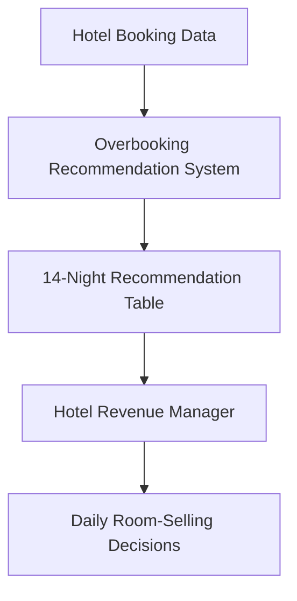
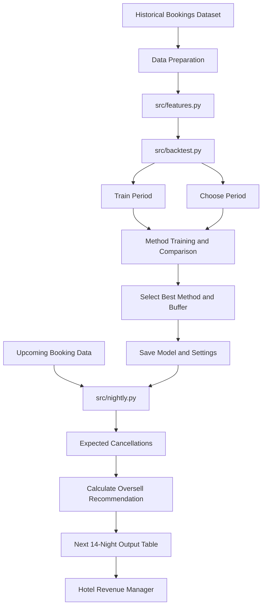

# What exactly are we building, and why this way?

**Owner:** Build Lead. **Closes:** ladder stages 3 and 5. **Length:** two pages and one diagram.

Write the options section on Wednesday, before the method table exists, and update it once the table is in. The architecture goes in on Thursday.

### 1. Who uses it, when, and what do they do with it?

> **Worked example.** The city operations lead opens the route table every evening, before routes are fixed, and adds the extra visits route by route. They overrule a route when a camp is cancelled at short notice.

**Our answer:** The hotel revenue manager uses the system each morning to review the next 14 arrival nights for both City Hotel and Resort Hotel. For each hotel and arrival night, the system estimates the number of cancellations and recommends how many rooms can be overbooked. The revenue manager uses this recommendation to make room-selling decisions while keeping the number of walked guests within the agreed business limit. 

<!-- answer3 -->

### 2. Which two ways could we decide, what does each cost, which do we choose, and what would flip it?

> **Worked example.** (a) A lookup table: the failure rate by booking channel and lead-time band, summed per route. Half a day to build, nothing to retrain. (b) A learned model of each booking's chance of failing, summed per route. Two days to build, retrained monthly. We choose (b) because it cuts idle slots by a further 9% with the guardrail met; we would flip to (a) if the gap fell under 3% on the next quarter's data.

**Our answer:**

<!-- answer:4 -->

### 3. What is our answer to the wish-list item?

_One paragraph with a number. Say which method the item would need and whether its output would change any number the client acts on._

**Our answer:**

<!-- answer:3 -->

### 4. What exactly is in the table the client reads?

> **Worked example.** One row per route and morning: route, date, slots booked, expected failures, buffer, extra visits to book, and a one-line reason.

**Our answer:** The system produces one row per hotel and arrival night, containing:

- Hotel
- Arrival date
- Bookings on book
- Expected cancellations
- Buffer
- Recommended oversell count

The table covers the next 14 arrival nights and gives the revenue manager a clear, actionable overselling recommendation for each night.

<!-- answer:2 -->

### 5. Which inputs do we use, by bin?

_Point to `docs/COLUMNS.md` and list here only the columns the method reads, each with its bin._

**Our answer:**

<!-- answer:3 -->

### 6. Where do the numbers come from, and how is the buffer set and frozen?

> **Worked example.** Each booking gets a probability of failing; the probabilities are summed per route; the buffer is the number of slots subtracted from that sum, chosen on the choose period as the cheapest buffer that keeps the guardrail, then frozen for the proof period.

**Our answer:**

<!-- answer:3 -->

### 7. What is the error bill on the proof period?

_Euros, rooms and walks per 1,000 for the chosen rule and for the client's flat rule, from `python src/backtest.py`._

| Rule | Empty rooms | Walked guests | Walks per 1,000 | Cost (EUR) | Saving a month against the flat rule (EUR) |
|---|---|---|---|---|---|
| Client's flat rule | | | | | 0 |
| Our chosen rule | | | | | |

### 8. What does the system look like, first as a black box and then inside?

#### A. Black-box architecture

The system takes historical hotel booking data and upcoming booking information as input. It generates a 14-night recommendation table showing expected cancellations and the recommended number of rooms to overbook. The hotel revenue manager uses this output to make daily room-selling decisions.

#### B. White-box architecture

The internal pipeline consists of the following stages:

1. The historical bookings dataset is loaded.
2. `features.py` prepares the data using approved booking-time features.
3. `backtest.py` trains and compares candidate methods using the train and choose periods.
4. The selected method and buffer are saved for future use.
5. `nightly.py` loads the saved method and generates recommendations for the next 14 arrival nights.
6. The output is presented as a hotel-wise nightly table.

#### C. Production additions

The current MVP is designed for a reproducible, file-based workflow. A production version could add:

| Addition | Why it matters |
|---|---|
| Automated hotel booking-system integration | Removes manual dataset uploads and keeps booking information updated |
| Scheduled daily execution | Generates recommendations automatically every morning |
| Dashboard for revenue managers | Makes recommendations and their explanations easier to review |
| Monitoring and model retraining | Detects changes in cancellation patterns and maintains model performance |
| Manual override and audit log | Allows managers to change recommendations and record their reasons |
| Alerts for high walk-risk nights | Helps managers identify nights where the walk-risk limit may be threatened |

**Important limitation:** The MVP uses the final-book evaluation setup. A production version should account for the fact that the number of bookings known 14 days before arrival may be lower than the final number of bookings.

<!-- answer:3 -->

### 9. What are the limits?

> **Worked example.** Runs in under five minutes on a laptop; every number has a one-line reason; no patient name leaves the lab's systems.

**Our answer:**

<!-- answer:2 -->

### 10. What could go wrong?

> **Worked example.** Camps cancelled at short notice cluster on the same routes; the failure rate drifts after a price change; route leads stop trusting the table after one bad morning.

**Our answer:**

<!-- answer:3 -->

### 11. What is out of scope?

**Our answer:**

<!-- answer:2 -->
